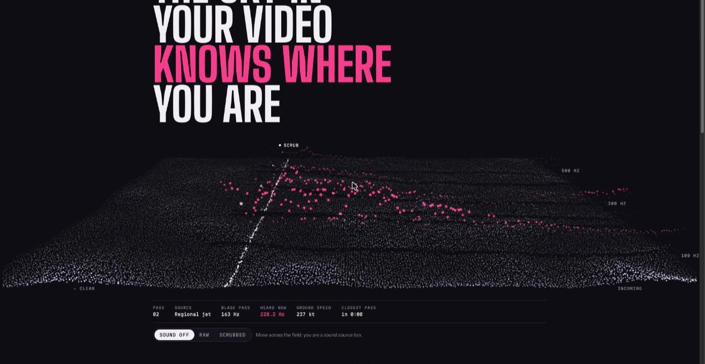
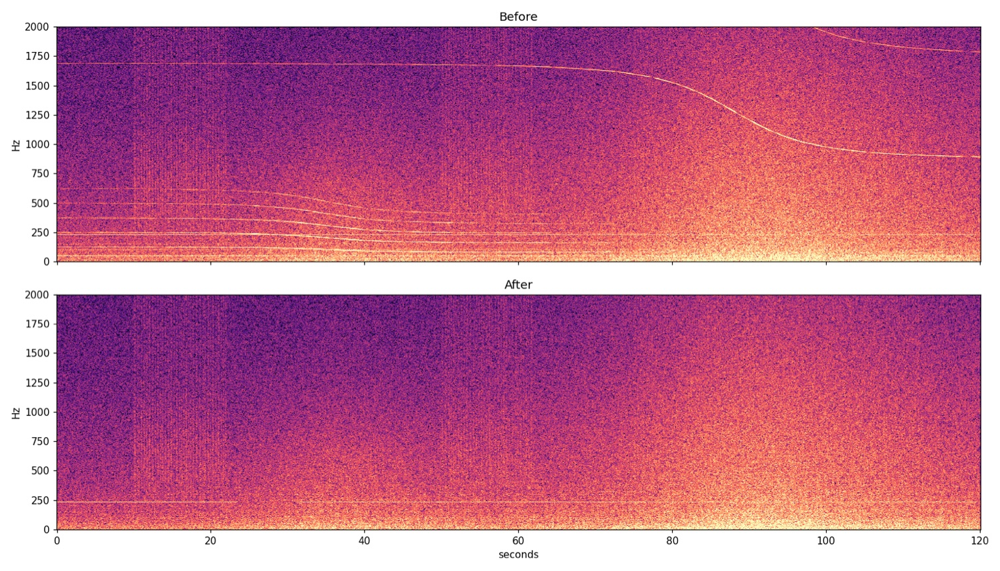

# Doppler Scrub

Removes the aircraft tones and mains hum that can place a video on a map. Runs on your device; your video is never uploaded.

**[Try it in the browser](https://dopplerscrub.com)** · [How it leaks](#how-a-clip-gets-located) · [Run it locally](#run-it-locally)



## Why this exists

A plane overhead leaves a sliding tone in your audio. Its pitch drops as it passes, and the shape of that drop gives away its speed and the second it flew over you. ADS-B flight tracks are public, so the curve can be matched to a real aircraft. [This video](https://www.youtube.com/watch?v=UytYrhYLOKI) shows it done: two flyovers 15 minutes apart were enough to find where a clip was filmed.

Doppler Scrub takes those tones out and leaves the rest of the sound. Hiding the method wouldn't help, because the attack is already public. So the code is open: anyone can check what the tool does to their video.

## How a clip gets located

1. **Record.** A turboprop's blades pass about 98 times a second. On the ground you hear about 128 Hz as it comes in and 80 Hz as it leaves.
2. **Measure.** Those two pitches give the speed, from `f′ = f · c / (c + v)`. The steepest point of the slide marks the moment it was closest.
3. **Match.** ADS-B logs every aircraft's position, every second. One pass narrows the location to a line on the map. Two passes give a point.

Mains hum is a second leak. The 50/60 Hz grid frequency drifts slightly over time, and forensic labs keep records of that drift. A clip with hum can be dated and tied to a power grid.

## What it removes and what it keeps

| Removed | Kept |
|---|---|
| Aircraft and vehicle tones | Voices |
| Mains hum, 50/60 Hz + harmonics | Birds, wind, traffic |
| GPS, capture time, device tags | Fans, fridges (unless `--strict`) |

The video picture is copied through untouched.

## Use it

**In the browser:** [dopplerscrub.com](https://dopplerscrub.com). Record a clip in the page, or pick one from your camera roll. You get back a clean copy plus a before/after spectrogram. The picture is copied untouched, so the file stays the size of the original. On the result screen, "Make smaller" re-encodes it at up to 1080p with the device's own encoder, which makes it about a third of the size. It reuses the audio that has already been cleaned. Processing runs on your device: [Pyodide](https://pyodide.org) runs `scrub.py`. The site's Content Security Policy lets the page connect only to itself and the engine CDN, so the browser itself blocks any upload. To check, open the network tab while it runs: the only requests are engine downloads.

The browser app doesn't use FFmpeg. Files are read and written by [Mediabunny](https://mediabunny.dev), which is pure TypeScript, so a malformed file can't corrupt memory. Audio is decoded by the browser's own decoders, which Apple, Google and Mozilla patch. Video is copied packet by packet and never decoded. The clean audio is encoded by the browser's AAC or Opus encoder. Where AAC is missing, a small wasm encoder takes over, and it only ever sees our own clean audio. Before any of that runs, `web/inspect.js` checks the container header and refuses anything but MP4/MOV/M4A, WebM/MKV and WAV with common codecs. The output carries no metadata from the input, so GPS, capture time and device tags are gone.

The site counts page views with Vercel Web Analytics, which sets no cookies and stores no personal data. It never sees your video or audio.

### Run it locally

You need Python 3 with `numpy`, `scipy` and `matplotlib`, plus `ffmpeg` for anything other than `.wav`. The CLI runs your system's FFmpeg directly, outside any sandbox, so keep it up to date.

```bash
git clone https://github.com/danielcanton/doppler-scrub
cd doppler-scrub
python3 scrub.py clip.mp4 clean.mp4 --plot before_after.png
```

| Flag | Does |
|---|---|
| `--strict` | Also removes every long steady tone |
| `--plot FILE` | Writes a before/after spectrogram |
| `--plot-fmax HZ` | Top of the plot (default 2000) |
| `-v` | Lists every removed tone |

To run the web app locally, copy `scrub.py` into `web/` and serve that folder (`python3 -m http.server -d web`).

## How it works

`scrub.py` is a single file of about 550 lines. The web app runs the same file.

1. Resample to 16 kHz. Take a short-time Fourier transform with 0.34 s windows, which gives 2.9 Hz frequency resolution, below 6.4 kHz.
2. Average the power over 0.3 s, so faint steady tones stand out from the noise.
3. Find spectral peaks at least 6 dB above the local floor, and track them over time.
4. Flag tracks that last 1.5 s or more and either glide monotonically, which is Doppler, or sit on a mains harmonic.
5. Chain on the flat approach and departure tones of each flagged glide. Their ratio would give the speed away.
6. Follow each curve into its faint start and end at a lower threshold. Tones already present on the far side of the pass are left alone, since they belong to a local machine.
7. Replace the flagged cells with noise shaped to the local floor. The noise comes from a real noise STFT, so the removed curve doesn't leave a darker trace.
8. Add only the difference back to the original audio. Everything outside the flagged cells stays untouched.

## Test it

```bash
python3 synth.py      # 2-min clip: turboprop + jet flyovers, 50 Hz hum, voice, birds, a steady 233 Hz tone
python3 evaluate.py   # scores the scrub against the known flight curves
```

| Check | Result |
|---|---|
| Flight curves vs noise control | within 1.5 dB |
| Re-scan: tones on a flight curve | 0 |
| Re-scan: mains hum | 0 |
| Steady 233 Hz tone kept | 10.0 → 9.5 dB |
| Distance to clean reference | 1.18 → 0.60 dB |
| Time, 2-min clip, laptop | 7.9 s |



## Limits

- **Barely tested on real audio.** Testing so far is the synthetic clip and one real 21 s phone clip. On the real clip, the bright part of a faint glide was removed, but its tail is still slightly visible. Real flyover recordings are the most useful contribution right now.
- **Jet rumble.** The broadband rumble of a jet still rises and falls as it passes, which hints at when it was overhead.
- **Light flicker.** Lamps on mains power flicker at 100/120 Hz. A camera can record that flicker in the picture, which carries the same grid signal as hum.
- **The picture.** Landmarks, signs, sun angle and accents are out of scope.

Treat it as one layer of privacy, not a guarantee.

## Contributing

- **Recordings.** Clips with a clearly audible plane, as original files (not re-sent through a messaging app), with the time and rough place if you're happy to share them.
- **Detector changes.** These must keep `evaluate.py` passing and must not make a real clip worse.

## Repo layout

```
scrub.py        the scrub (CLI + library)
synth.py        synthetic test clip with known flight curves
evaluate.py     scores a scrub against those curves
web/            landing page (/) and app (/app): Pyodide worker, Mediabunny I/O, input check, the live field
```

## License

MIT. See [LICENSE](LICENSE).
